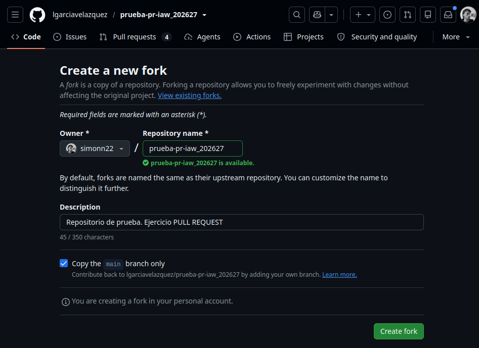
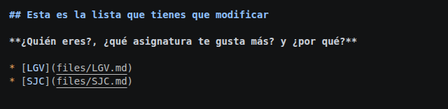
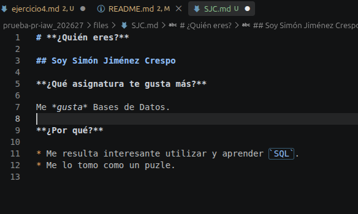
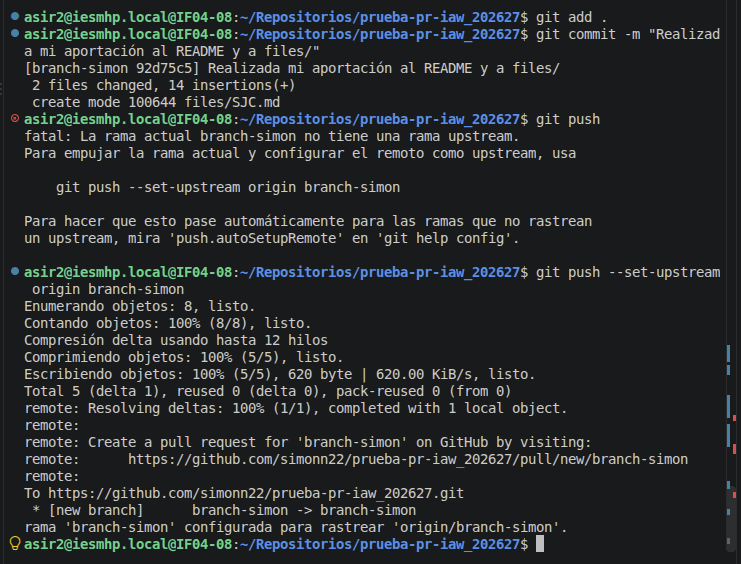
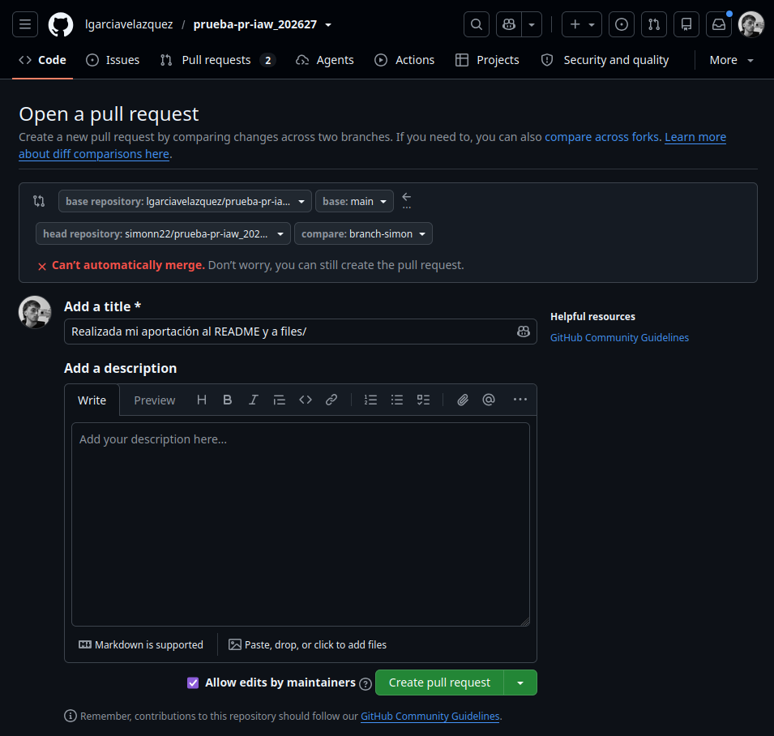
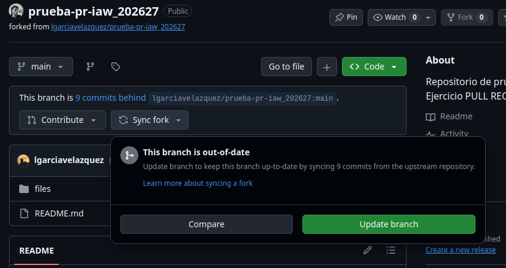
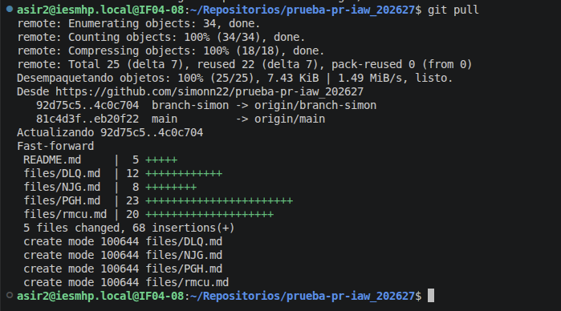

# Ejercicio 4

## Crear el fork del repositorio

## Edito mi fork

## Hago el commit con mis cambios a mi fork

## Hago la pull request

## Sincronizo los cambios una vez mi pull request ha sido aceptada

